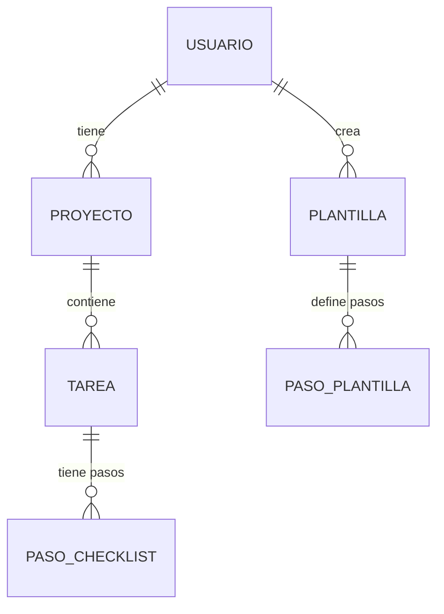

# Modelo de datos

## Decisiones de diseño

- Se guarda `hashContrasena`, nunca la contraseña real.
- `Tarea` no tiene `usuarioId`: el dueño se obtiene a través del proyecto (normalización).
- Toda tarea pertenece a un proyecto. Al registrarse se crea el proyecto "Personal".
- `estado` y `prioridad` son enums para restringir sus valores.
- `posicion` guarda el orden en el tablero Kanban y en los checklists.
- Al usar una plantilla, sus pasos se **copian** a la tarea (no se enlazan).
- Los datos del dashboard se calculan con consultas, no se guardan.
- Se usan UUID como identificadores.
- Borrado en cascada: proyecto → tareas → pasos.